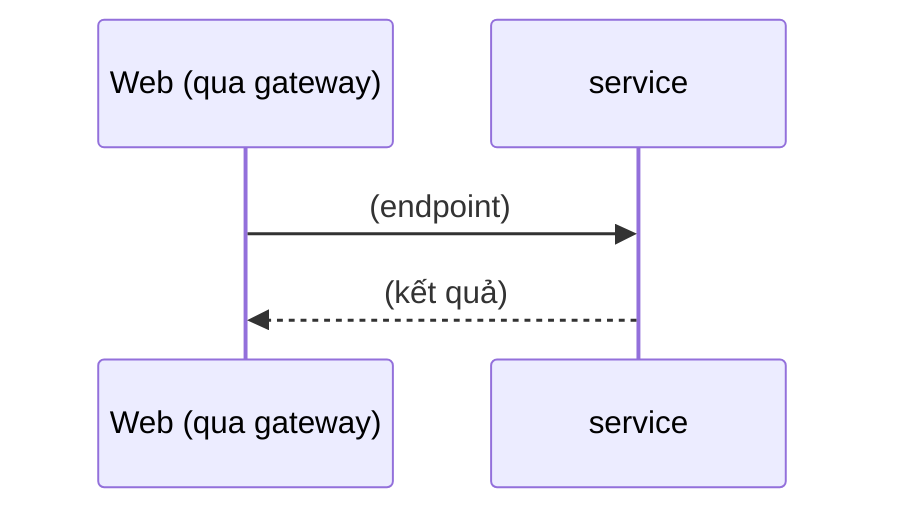

# Service `service`

Thẻ của service: AI và người đọc tệp này trước khi sửa mã. Chủ service cập nhật nó **trong cùng
commit** với mã theo luật ở mục 4 của `CLAUDE.md` (CI `pnpm check:docs` nhắc khi quên). Mẫu này nằm
trong khuôn; `scripts/new-service.sh` điền tên.

## Thông tin

| | |
| --- | --- |
| Chủ | (tên, tài khoản GitHub) |
| Cổng mặc định | (xem bảng ở `docs/HE_THONG.md`) |
| Schema PostgreSQL | `PG_SCHEMA=service` |
| Gọi qua gateway | `/api/service/...` |

## Sơ đồ mã

Mỗi tệp trong `service/src` một dòng: làm gì. AI đọc bảng này thay vì mở từng tệp.

| Tệp | Làm gì |
| --- | --- |
| `main.ts` | Khởi động: `bootstrapService({ module, name, port })` |

## Sơ đồ luồng

Luồng chính của service (Mermaid). Sửa khi đổi luồng, thêm lời gọi sang service khác hoặc sự kiện.

## Dữ liệu sở hữu

Chỉ service này ghi các bảng (collection) dưới đây; service khác hỏi qua API hoặc sự kiện.

| Collection | Ý nghĩa | Khai báo trong `packages/contracts/resources.json`? |
| --- | --- | --- |

## Endpoint

Chi tiết ở `service/openapi.yaml`. Mỗi endpoint có ít nhất một lỗi nghiệp vụ 4xx kèm mã.

| Phương thức, đường dẫn | Quyền | Lỗi nghiệp vụ |
| --- | --- | --- |

## Sự kiện

| Phát | Nhận |
| --- | --- |

## Nguồn CodeCash

Tệp trong `../codecash` chuyển vào service này (xem `docs/DOI_CHIEU_CODECASH.md`), và đã chuyển chưa.

| Tệp cũ | Sang | Trạng thái |
| --- | --- | --- |

## Rà soát nghiệp vụ

Chỗ mã cũ lệch, thiếu so với `../codecash/docs/NGHIEP_VU.md`, và đã xử lý thế nào.

## Cải tiến so với CodeCash

Những gì làm khác hoặc tốt hơn bản cũ, và vì sao (dùng cho báo cáo).
